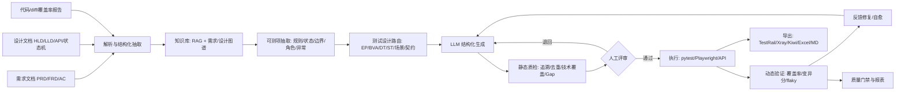

# 从需求 / 设计 / 代码生成高质量测试用例：开源生态调研

> **后续更新（2026-11-07）**：本报告已做二次审查与补遗，新增文档解析、开源 TCMS/追溯、契约/属性/变异测试、测试影响分析、LLM/Agent 评测、Agent Skills 标准与供应链安全等类别，并给出分类对比与 TOP10 推荐。详见同目录《调研审查-补遗-与TOP10推荐-2026-11.md》。  
> 调研时间：2026-11-07  
> 范围：开源或 source-available 的**专用测试 Agent、Agent Skills、工具/平台、提示词模板、编排框架、评测基准**。  
> 不含：Claude Code、Codex、Cursor 等通用 coding agent 本身（它们是宿主，不是测试用例生成方案）；但会说明哪些 Skill/MCP 可挂载到这些宿主上。  
> 口径说明：GitHub star、技能数量、版本号均来自检索时的公开页面/聚合站，变化很快；落地前请以仓库 LICENSE、最近 commit、issue 活跃度为准。部分项目是单维护者 demo，不建议直接上生产。

---

## 0. 结论先行（TL;DR）

1. **没有一个开源项目能把“需求文档 + 设计文档 + 代码”三类输入都端到端做到生产级。** 现实可行的是三层组合：
   - **文档层**：RAG/结构化抽取 + 测试设计方法（EP/BVA/决策表/状态迁移）+ 追溯矩阵；
   - **代码层**：执行反馈 + 覆盖率 + 变异测试闭环；
   - **运行层**：Playwright/浏览器 Agent + 自愈 + CI。
2. **只要一个起点：**
   - Claude Code / Codex / Cursor 用户：`naodeng/awesome-qa-skills`（技能库）+ `casely-qa-skill`（文档→TestRail 用例）+ `sethdford/claude-skills` 的 `test-case-design`（ISTQB 方法）。
   - 想要 Web 平台/私有化：`WHartTest`、`WardenIQ`、`ChiufungLee/AI-Test-Case-Generator`。
   - 想要 CLI/CI：`TestTeller`、`lingtest-cli`、`Agentic QE Fleet`、`Kane CLI`。
   - 代码级单测：`Cover-Agent`、`TestSpark`、`AutoCover-Lite`、`Mutahunter`。
   - E2E：`e2e`、`Midscene.js`、`Shortest`、`agent-qa`/`passmark`、Playwright MCP。
   - 自建：`LangGraph` + RAG + 结构化输出 + `Schemathesis`/`Keploy`/`Pynguin` + 覆盖率/变异门禁。
3. **质量关键不是“生成更多用例”，而是：**
   - 每条验收标准（AC）都有正例、负例、边界（适用时）；
   - 每条用例可追溯到需求/设计章节；
   - 用例可执行、可重复、不 flaky；
   - 能杀死变异体（mutation score），而不只是刷行覆盖率；
   - 明确列出“文档未定义、需要人确认”的信息缺口，而不是让模型编造预期结果。
4. **最容易踩的坑：** 许可证（`awesome-qa-skills` 是 PolyForm Noncommercial，不是 OSI 开源；`agent-qa` 是 fair-source/NOASSERTION）、单维护者项目、RAG 切块破坏表格/状态机、模型幻觉出的预期结果、生成测试与实现耦合、外发文档的数据合规。

---

## 1. 问题拆解：什么输入，能生成什么测试资产

| 输入 | 可抽取的测试要素 | 推荐设计方法 | 典型输出 | 代表工具 |
|---|---|---|---|---|
| PRD / FRD / 用户故事 / AC | 业务规则、角色权限、状态、字段约束、异常分支 | 等价类、边界值、决策表、状态迁移、场景法、错误推测 | 功能用例、验收用例、异常/权限/边界用例、需求追溯矩阵 | Casely、qc-ai-skills、WHartTest、WardenIQ、AI-Test-Case-Generator、TestAxiom、lingtest |
| HLD / LLD / API 契约 / 时序图 / 状态机 | 接口契约、依赖、幂等/重试/超时、数据一致性、故障路径 | 契约测试、状态迁移、成对组合、故障注入、属性测试 | 集成用例、契约用例、异常/补偿用例、非功能场景 | TestTeller、Schemathesis、qa-mcp、Keploy、ASSERT |
| 代码 / diff / 覆盖率报告 | 分支、边界、异常、未覆盖路径、变异体 | 执行反馈生成、覆盖率驱动、变异驱动、属性测试 | 单元测试、回归测试、失败复现测试 | Cover-Agent、TestSpark、AutoCover-Lite、Mutahunter、Pynguin/EvoSuite |
| 运行中的 UI / 真实流量 | 用户旅程、页面状态、真实请求/响应 | 自然语言驱动、视觉定位、录制回放、探索式 | E2E 用例、可执行脚本、缺陷报告 | e2e、Midscene.js、Kane CLI、Shortest、agent-qa、Playwright MCP |

> 关键认知：**需求/设计文档决定“测什么”，代码/执行决定“测得对不对”，运行系统决定“用户路径通不通”。** 三者不要混在一个 prompt 里做，应该分阶段、分 Agent、分质量门禁。

---

## 2. 专用 Agent / Agent Fleet（不含通用 coding agent）

| 项目 | 形态 | 核心机制 | 强项 | 注意点 |
|---|---|---|---|---|
| [Agentic QE Fleet](https://github.com/proffesor-for-testing/agentic-qe)（`agentic-qe`） | Agent 集群 + Skills + MCP + CLI | `qe-queen-coordinator` 编排约 60 个 QE agents，覆盖 13 个域；官方站点口径约 76 个 skills；`aqe init` 初始化；MCP 工具 `test_generate`/`test_execute`/`coverage_analyze` | 覆盖测试生成、执行、覆盖率、缺陷情报、契约、视觉/无障碍、混沌/性能、学习；可挂 Claude Code/Cursor/Copilot 等约 11 个平台 | 体量大、版本迭代快（agent/skill 数量在不同版本不一致）；先小范围试用，别一次性全开 |
| [e2e](https://github.com/tester-army/e2e)（原 TesterArmy） | Playwright + AI Agent + CLI/SDK/MCP | 自然语言描述目标 → Agent 操作页面 → 用 Playwright locator/assertion 验证；验证过的步骤缓存重放，页面变化才重新调用模型 | Web + 移动端 E2E；缓存显著降本；Apache-2.0；约 12k stars（检索时） | 偏 E2E，不解决需求文档→用例设计；缓存失效/页面改版需关注 |
| [Kane CLI](https://github.com/LambdaTest/kane-cli) | CLI + Agent Skill + MCP | 纯英文目标驱动真实 Chrome；首次录制、后续缓存重放；`generate` 从描述生成场景/用例；`assurance` 串起 PRD→用例→测试→需求覆盖；输出 evidence 包 | 需求关联覆盖、证据链、CI（NDJSON/退出码）、移动端、Playwright 代码导出；Apache-2.0 | 依赖其运行环境/云能力；复杂业务断言仍需人工补充 |
| [Midscene.js](https://github.com/web-infra-dev/midscene) | 视觉驱动 UI 自动化 SDK | 截图 + 多模态模型规划操作；`aiAct`/`aiWaitFor`/`aiAssert`/`aiQuery`；YAML 用例 | Web/Android/iOS/HarmonyOS/桌面跨端；对 canvas、图标按钮、跨域 iframe 友好；MIT；约 15k stars | 视觉模型成本/稳定性；复杂断言建议配合传统断言 |
| [Shortest](https://github.com/antiwork/shortest) | 自然语言 E2E 框架 | 英文测试描述 + Claude computer-use + Playwright 执行；支持 callback 断言、hook、测试链 | 上手快，适合 smoke/主流程；MIT；约 4.4k stars | 采用度仍早期；复杂场景/稳定性不如成熟 Playwright 套件 |
| [agent-qa](https://github.com/vostride/agent-qa) | 自然语言测试 + 自愈 + MCP | Web/移动端自然语言用例；执行中重新观察 UI 并尝试替代路径；跨运行记忆、动作缓存、Docker 沙箱 hooks | 自愈、跨端、Dashboard/CLI、MCP | 许可证显示 NOASSERTION/fair-source，商用前必须确认 |
| [passmark / qa-agent](https://github.com/bug0inc/passmark) | Playwright AI 回归库 | 自然语言步骤 + 智能缓存 + 自愈 + 多模型断言 | 适合把 AI 步骤嵌入现有 Playwright 回归 | 约 1.3k stars，较新；API 可能变动 |
| [AutoCover-Lite](https://pypi.org/project/autocover-lite/) | 多 Agent Python 测试生成 | Preparer/Generator/Executor/Validator/Fixer 五 Agent；Docker 沙箱；只保留通过 + 提升覆盖率 + 通过变异测试的用例 | 代码级单测闭环；报告称行覆盖 80.9%→92.5%、变异分 56.8%→74.8% | 偏 Python/pytest；依赖 Docker；成本较高 |
| [selenium-python-ai-agent](https://pypi.org/project/selenium-python-ai-agent/) | Planner→Generator→Healer | 实时 DOM 扫描避免猜选择器；修复后重跑验证；`init-agents` 集成 Claude Code | Selenium/pytest/pytest-bdd 存量项目 | 生态较窄；维护活跃度需确认 |
| [autonomous-test-agent](https://github.com/mdemir3/autonomous-test-agent) | LangGraph 多 Agent | URL + 需求 → locators、测试用例、Behave `.feature`、Playwright step definitions；可选 locator healer | BDD 全链路参考实现 | 更像参考项目；生产化需补权限/稳定性 |
| [ASSERT](https://github.com/responsibleai/ASSERT) | Agent 评测框架 | 自然语言规格 → 行为类别 → 测试用例 → 推理 → LLM-judge；支持 LangGraph/CrewAI/AutoGen/DSPy 等 | 如果你要测的是“AI Agent 本身”，它很合适 | 不是“给业务系统生成用例”的工具，别混用 |
| [AgentQA](https://pypi.org/project/agentqa/) | 多 Agent 系统测试 | AST 扫描 CrewAI/LangGraph/AutoGen 代码 → YAML 场景 → 模拟交互，查死锁/信息泄露/角色越权 | 测多 Agent 协作的失败模式 | 面向 Agent 系统，不是普通 Web/API 用例 |

**选型建议：**
- 要“一个平台把 QA 全流程都覆盖”：先看 **Agentic QE Fleet**，但要做减法。
- 要“需求→E2E 且有证据链”：看 **Kane CLI**。
- 要“现有 Playwright 体系加 AI”：看 **e2e** / **passmark**。
- 要“跨端 + 视觉定位”：看 **Midscene.js**。
- 要“代码级单测闭环”：看 **AutoCover-Lite** / **Cover-Agent**。

---

## 3. Agent Skills（Claude Code / Codex / Cursor / 兼容宿主）

> Agent Skill 本质是“带触发描述的结构化操作手册 + references + scripts”，不是一段长 prompt。质量差异极大，建议优先选**带脚本做确定性校验**（覆盖率、去重、Excel 导出）的技能。

| 项目 | 形态/规模 | 覆盖能力 | 亮点 | 许可/注意 |
|---|---|---|---|---|
| [naodeng/awesome-qa-skills](https://github.com/naodeng/awesome-qa-skills) | 双语技能库；README 声称 166 个/语言（共 332） | 需求分析、测试用例、功能/API/UI、回归、性能、安全、AI/LLM/Agent 测试、Skill 工程 | 分类全、双语、可按技能独立安装；`npx skills add naodeng/awesome-qa-skills --skill functional-testing` | **PolyForm Noncommercial 1.0.0**：非商业使用；商用需授权 |
| [naodeng/awesome-qa-prompt](https://github.com/naodeng/awesome-qa-prompt) | 提示词库 | 14 个测试类型模块 + 3 个工作流模块；含用例生成、AI 生成用例评审、幻觉分析、红队设计 | 中英双语、full/lite 版本；适合做团队 prompt 基线 | 提示词库，不含执行闭环 |
| [tuyenvo224/qc-ai-skills](https://github.com/tuyenvo224/qc-ai-skills) | QC 流水线技能集 | `requirement-analyzer → risk-scout-analyzer → bug-hunter → test-case-generator → 执行` | `test-case-generator` 明确用 EP/BVA/DT/ST，脚本算覆盖率，输出 Excel + Summary/Coverage/Traceability | 流水线设计很适合企业；需确认许可证与维护状态 |
| [JohnWayneeee/casely-qa-skill](https://github.com/JohnWayneeee/casely-qa-skill) | 文档→用例 Skill | PDF/DOCX/XLSX/TXT/MD、Jira、Confluence → TestRail 就绪的 XLSX/CSV；API 规格 → Postman collection；trace ID → bug report | 5 阶段（Intake→Style guide→Test plan→Generate→Export）；可读团队样例文件复制列/ID 规范；MIT | 依赖 Atlassian MCP（只读）与可选 Playwright MCP；云版/付费计划限制 |
| [sethdford/claude-skills](https://github.com/sethdford/claude-skills) 的 `test-case-design` | 单技能（约 47 行 SKILL.md） | ISTQB 黑盒方法：EP/BVA/决策表/错误推测；5 步流程；反模式与 Guard | 简洁、可读，适合作为自建 Skill 的骨架 | 能力偏“设计”，不含文档解析/执行 |
| [@apoorvgarg31/test-architect](https://www.npmjs.com/package/@apoorvgarg31/test-architect) | npm Skill | 交互式问答；自动识别 Jest/Vitest/Pytest；生成 happy path/edge/error 套件 | `/test-architect` 即用 | 偏代码级；复杂项目需补充上下文 |
| [buer2233/ai-api-test-skill](https://github.com/buer2233/ai-api-test-skill) | API 测试 Skill | Python + pytest + requests；预检门禁、渐进式披露、流量驱动用例、SQLite API 索引、pytest 闭环验证 | 工程化程度高，适合接口自动化 | 绑定 Python/pytest 技术栈 |
| [@wychmod-cn/testcase-generator-skill](https://www.npmjs.com/package/@wychmod-cn/testcase-generator-skill) | npm Skill | 六阶段：输入预处理→需求预处理→代码分析→领域建模→MBT 设计→用例生成 | 输出 Markdown/Gherkin/JSON + 追溯矩阵；可激活到 8 个宿主 | MBT 建模质量依赖输入结构；需试跑 |
| [joe-qai/qa-skills](https://github.com/joe-qai/qa-skills) | 中文 QA 技能集 | 需求分析、测试规划、用例生成、执行；多文档格式抽取 | 中文团队友好、模块化 | 维护/许可需确认 |
| [kao273183/qa-claude-skill](https://github.com/kao273183/qa-claude-skill) | 24 个 QA Skills | 测试设计、自动化、缺陷管理、质量量化、报告、性能安全、CI 健康 | 覆盖面广，MIT（非商业） | 需逐技能评估质量 |
| [yonatangross/orchestkit](https://github.com/yonatangross/orchestkit) 的 `cover` | 单 Skill（参考实现） | 按 unit/integration/E2E 分层找缺口；并行 test-generator agents；行为门禁；最多 3 轮自愈 | SKILL.md 写得很完整，适合学习“技能编排” | 偏代码测试补齐，不是文档用例 |
| [gvm-test-cases](https://skillsmp.com/creators/gerquinn1978/gvm/grounded-vibe-methodology-skills-gvm-test-cases) | 单 Skill | 读 `requirements/requirements.md` → Given/When/Then + 需求追溯 + 覆盖矩阵 + HTML/MD 报告 | 轻量、可追溯 | 生态小，需验证 |
| [test-case-generation](https://skills.rest/skill/test-case-generation)（ksmuvva） | 社区 Skill | unit/integration/E2E、fixtures、factories、安全检查、覆盖率摘要 | 适合快速补测试 | 社区技能，质量参差 |

**Skills 使用建议：**
- **不要直接堆 100 个技能。** 先选 3 个：需求分析 1 个、用例设计 1 个、执行/自愈 1 个。
- **优先选带 `scripts/` 的技能**：Excel 导出、覆盖率计算、去重、追溯矩阵校验应由脚本做，而不是让模型“自称覆盖了”。
- **把团队规范写进 Skill 的 `references/`**：列名、ID 规则、优先级枚举、用例模板、禁用词。
- **商用前查许可证**：PolyForm Noncommercial、fair-source、NOASSERTION 都不是标准 OSI 开源。

---

## 4. 工具 / 平台：需求文档 / 设计文档 → 测试用例

| 项目 | 形态 | 输入 | 输出/能力 | 亮点 | 注意点 |
|---|---|---|---|---|---|
| [WHartTest](https://atomgit.com/gh_mirrors/wh/WHartTest) | Django + DRF Web 平台 | 需求文档上传/解析/评审 | AI 生成功能/接口/UI 用例；LangChain/LangGraph + RAG + MCP | 中文生态、功能完整、适合私有化 | 项目较新；部署/权限/模型接入需评估 |
| [WardenIQ](https://github.com/adlerqa/wardeniq) | Web 平台 + Docker | 需求、文档、代码变更 | 测试用例、测试计划、覆盖率洞察、发布测试周期 | 本地模型 + MongoDB 打包；Linux/Windows 安装说明 | 平台较重；先看模型效果与数据隔离 |
| [AI-Test-Case-Generator](https://github.com/ChiufungLee/AI-Test-Case-Generator)（ChiufungLee） | FastAPI + LangGraph + ChromaDB | 需求文档 | 需求分析 Agent → 人工评审（interrupt/resume）→ 用例生成 Agent → 确定性覆盖检查（集合运算 + RapidFuzz）；CSV 导出、版本化 | **架构参考价值高**：human-in-the-loop + 确定性校验，不靠 LLM 自评 | 需要自己配模型/知识库；前端/权限较简 |
| [TestTeller](https://pypi.org/project/testteller/)（iAviPro/testteller-agent） | CLI RAG Agent | PRD、HLD/LLD、API 契约、schema、GitHub/本地代码 | 技术用例 + 用户旅程用例 + 可执行 pytest/Jest/Playwright/Cypress/JUnit | 文档+代码双输入；多模型（Gemini/OpenAI/Claude/Ollama）；ChromaDB | CLI 形态；复杂项目需调 chunk/检索 |
| [lingtest-cli](https://pypi.org/project/lingtest-cli/) | CLI | requirements.md、OpenAPI | 需求歧义/矛盾/可测性风险分析；功能/边界/异常/接口用例；JUnit 报告 | “先审需求再生成”的思路很好；支持 DeepSeek/Qwen/OpenAI 兼容端点 | 项目较新；用例深度需实测 |
| [TestAxiom](https://pypi.org/project/testaxiom/) | CLI/库 | 需求 | LLM + ISTQB 确定性方法（EP/BVA/决策表/正交/状态迁移）；每个用例带数学依据；需求→技术→用例追溯；导出 pytest 参数 | 强调可解释、可追溯 | 方法论严谨但覆盖场景有限；需确认维护 |
| [testcase-generator](https://hub.docker.com/r/xuxuclassmate/testcase-generator)（xuxuclassmate） | Docker Web | PDF/Word/TXT/图片/视频 | 三角色评审（测试/开发/产品）循环；Excel/Markdown/XMind 导出 | 多模态输入、评审闭环、中英双语 | GitHub 仓库与镜像需对齐版本 |
| [AI-Test-Case-Generator](https://github.com/sauravhingade/AI-Test-Case-Generator)（sauravhingade） | FastAPI + Streamlit | PDF/DOCX | 用户故事 → BDD（Given/When/Then）；RAG 自改进；Excel/CSV/JSON | 参考架构清晰：Pydantic 结构化输出、LangSmith、Docker Compose | Demo 性质较强 |
| [ByteDance--Auto_prd_test_agent](https://github.com/zxLeva/ByteDance--Auto_prd_test_agent) | Agent 流水线 | PRD、UI 设计图（Gemini Vision） | Funnel RAG（切块→向量召回→LLM 过滤）；AI Critic 对抗评审；CSV/Excel/YAML/JSON/MD | 多模态 + 对抗评审 | 名称像内部项目外流；生产可用性需验证 |
| [FRIDAY CLI](https://pypi.org/project/friday-cli/) | CLI | Jira ticket、GitHub issue、Confluence | LangChain 提示词工程 → JSON/Markdown 用例 | 直接接研发工作流 | 依赖 Vertex AI/LangChain；维护情况需查 |
| [qa-mcp](https://pypi.org/project/qa-mcp/) | MCP Server | 功能描述 + AC | 生成标准化用例、lint/归一化、套件组合、覆盖率报告、Xray payload | 生成 + 测试管理打通；9 个离线纯函数工具 | 单维护者；Xray 写入需显式开启 |
| [testrail-mcp-server](https://github.com/uarlouski/testrail-mcp-server) | MCP Server | TestRail | 用例/运行/结果 CRUD；`export_cases_for_rag`；CLI | 适合把生成结果直接入库 | 商业 TestRail；读写删除需环境变量门禁 |
| [kiwi-tcms-mcp](https://github.com/FabriceMIQUETSAGE/kiwi-tcms-mcp) | MCP Server | PRD/设计文档 | Kiwi TCMS 计划/用例/运行；自带 `kiwi-tcms-test-generation` Cursor skill | **Kiwi TCMS 是少数真正开源的 TCMS**；端到端“生成+管理” | 生态小；需自部署 Kiwi |
| [mXray](https://github.com/Timorek/mXray) | MCP Server | Xray Cloud | 28 个工具：测试、执行、计划、集合、导入导出 | Jira/Xray 深度集成 | 商业 Xray；社区维护 |

**共同架构模式（值得抄）：**
1. 文档解析 → **结构化抽取**（规则、字段、状态、角色、异常），不是直接整篇塞模型；
2. **需求评审/人工确认**（interrupt/resume）后再生成，避免错在起点；
3. 生成后用**确定性检查**做覆盖/去重/追溯（集合运算、RapidFuzz、脚本），不让模型自评；
4. 导出到团队现有 TCMS（TestRail/Xray/Qase/Zephyr/Kiwi）或 Excel/Markdown；
5. 版本化用例与需求，支持增量更新。

---

## 5. 代码级测试生成：单元 / 集成 / 回归

| 项目 | 生态 | 机制 | 强项 | 注意点 |
|---|---|---|---|---|
| [Cover-Agent](https://github.com/Codium-ai/cover-agent)（现 [qodo-cover](https://github.com/qodo-ai/qodo-cover)） | 多语言 CLI | Test Runner + Coverage Parser + Prompt Builder + AI Caller；循环生成直到目标覆盖率；LiteLLM 支持多模型 | Meta TestGen-LLM 的首个公开实现；“extend-and-prune”思路；可接 100+ 模型 | 早期偏 Java/Kotlin 提示词；对复杂项目上下文不足；需人工审查断言 |
| [TestSpark](https://github.com/JetBrains-Research/TestSpark) | Java / IntelliJ | EvoSuite（搜索式）+ LLM 生成 + 修复/可读性改进；行/分支/弱变异覆盖可视化 | IDE 内点击生成；ICSE 2024 Demo；两种范式互补 | 绑定 IntelliJ/JVM；LLM 需配 token |
| [AutoCover-Lite](https://pypi.org/project/autocover-lite/) | Python / pytest | 五 Agent 闭环；Docker 沙箱；只保留通过 + 提升覆盖 + 通过变异测试的用例 | 质量门禁最完整；有量化提升报告 | 成本/耗时；Docker 依赖 |
| [Mutahunter](https://github.com/codeintegrity-ai/mutahunter) | 语言无关 | LLM 生成变异体 + LLM 生成单测；基于 Cobertura/JaCoCo/lcov；diff 模式；存活变异体分析 | 变异驱动比纯覆盖率更抗“假测试”；LiteLLM | 约 247 stars；LLM 变异体需等价性筛查，否则噪声大 |
| [mutation-agent](https://github.com/trbarron/mutation-agent) | Python 为主 | mutmut / mutahunter + LLM triage + 自修正 + 验证 | 闭环参考实现；受 Meta ACH 启发 | 研究型项目；生产化需补工程 |
| [Pynguin](https://github.com/se2p/pynguin) | Python | 搜索式测试生成（SBST），生成高覆盖 pytest 套件 | Python 事实标准；与 LLM 互补 | 生成测试 flaky 率较高；建议固定随机种子 |
| [EvoSuite](https://github.com/EvoSuite/evosuite) | Java | SBST，成熟；有 flaky 抑制机制 | Java 单测覆盖强；研究/工业都用 | 生成测试可读性一般；需配合 LLM 改写 |
| [Schemathesis](https://github.com/schemathesis/schemathesis) | OpenAPI / GraphQL | 基于 schema 的属性/模糊测试，自动生成大量输入 | 契约覆盖强、能发现人工漏掉的边界；CI 友好 | 会产生噪声；只能验证 schema 内约束 |
| [Keploy](https://github.com/keploy/keploy) | Go/Java/Node/Python/Rust/C# 等 | eBPF 捕获真实 API/DB/队列流量 → YAML 用例 + mock → 回放回归 | 零代码、真实流量、依赖 mock 自动生成；Apache-2.0 | eBPF 需 Linux/特权（Windows/macOS 需 Docker/WSL）；录制含时间戳/token 噪声 |
| [Hypothesis](https://github.com/HypothesisWorks/hypothesis) | Python | 属性测试 + 自动缩小反例 | 补 LLM 想不到的输入空间；与 pytest 集成 | 需要写属性/oracle，不是“一键生成” |

**代码级质量门禁建议：**
- 生成测试必须**编译/运行通过**；
- 必须**提升行/分支覆盖**，否则丢弃；
- 必须**通过变异测试**（至少抽样），否则只是“调用代码 + assert True”；
- 连续运行 3–5 次检查 flaky；
- 断言应面向行为/契约，不应复制实现细节；
- 对 diff 只生成受影响范围的测试，控制成本。

---

## 6. 框架 / 编排 / 协议（自建 Agent 的积木）

| 类别 | 代表 | 用法 | 注意 |
|---|---|---|---|
| 状态图编排 | **LangGraph** | 需求解析→评审→生成→校验→导出；支持 interrupt/resume、human-in-the-loop | 很多开源项目的实际底座（AI-Test-Case-Generator、autonomous-test-agent） |
| 多 Agent 角色 | **CrewAI / AutoGen** | PM/QA/Dev/Critic 多角色协作、对抗评审 | 角色越多越容易“互相附和”；要有确定性门禁 |
| 工具协议 | **MCP** | 把浏览器、Jira/Confluence、TestRail/Xray/Kiwi、文件系统接给 Agent | 权限最小化；写入类工具要显式开关 |
| 浏览器工具 | **Playwright MCP** / **Chrome DevTools MCP** | Playwright 负责“驱动”（导航/点击/输入/可复现）；DevTools 负责“诊断”（console/network/性能/内存） | 两者定位不同；Playwright 默认跨浏览器，DevTools 仅 Chrome；注意 token 消耗 |
| RAG | **Chroma / Qdrant / Milvus / FAISS + LangChain/LlamaIndex** | 需求/设计/历史用例检索；few-shot 取“团队风格” | 结构化文档优先按标题/表格/状态机切块；不要固定长度硬切 |
| 结构化输出 | **Pydantic / Instructor / JSON Schema** | 强制用例字段、枚举、必填项 | 比“请输出 JSON”可靠得多 |
| 确定性校验 | **coverage.py / JaCoCo / Cobertura、mutmut/Stryker/PIT、RapidFuzz** | 覆盖率、变异分、去重、追溯 | 这些应是门禁，不是模型自评 |
| Prompt 测试 | [PromptPex](https://github.com/microsoft/promptpex) | 把 prompt 当函数：意图分析→输入规格→输出规则→反向规则→测试生成→评估器 | 用来测“你的用例生成 prompt”本身，减少回归 |
| 规格驱动 Agent 评测 | [METIS](https://govtech-responsibleai.github.io/metis/) | PRD/设计文档 → 可度量规格 → personas/scenarios/test cases → 轨迹评估 | 更适合评估 Agent 行为，不是生成业务用例 |
| 通用 RAG/Agent 评测 | [openagent-eval](https://pypi.org/project/openagent-eval/) | 检索指标 + 忠实度/幻觉 + 合成测试用例 + 实验对比 | 可用于评估“生成用例的检索质量” |

> 通用 Agent 框架（LangGraph/CrewAI/AutoGen）只是积木，不提供测试设计方法；测试设计方法必须显式写进 prompt/skill。

---

## 7. 提示词模板与提示词库

### 7.1 最有效的结构：RCTF + 显式方法论

- **Role**：资深测试分析师 / ISTQB Advanced Test Analyst；
- **Context**：需求原文、AC、字段约束、状态机、技术栈、团队用例模板；
- **Task**：明确要求使用哪些技术（EP/BVA/决策表/状态迁移/场景法/错误推测），并规定每个 AC 的最少覆盖；
- **Format**：固定表头/JSON Schema + 追溯列 + 测试数据列 + 优先级 + 技术列；
- **Self-check**：生成后自检“遗漏/重复/不可执行/臆造预期”，输出 Gap List；
- **Grounding**：只依据给定材料；未定义的信息列入“待确认”，禁止编造。

**关键经验：不点名技术，模型默认只给 happy path。** 必须显式写“等价类 + 边界值（min-1/min/min+1/max-1/max/max+1）+ 负例 + 权限 + 并发/幂等（适用时）”。

### 7.2 可复用提示词库

| 来源 | 内容 | 适合 |
|---|---|---|
| [naodeng/awesome-qa-prompt](https://github.com/naodeng/awesome-qa-prompt) | 14 个测试类型 + 3 个工作流；中英双语；full/lite | 团队 prompt 基线 |
| [qa.codes AI Prompt Library](https://qa.codes/ai/prompts) | 65 个 prompt / 15 类；含 BDD、自动化、API、安全、无障碍、AI 模型测试 | 快速取用 |
| [The Testing Academy Prompt Library](https://app.thetestingacademy.com/blog/prompt-library-for-qa) | 50+；含 EP、状态迁移、Playwright/Selenium/REST Assured | 手工测试转自动化 |
| [Ai4Testers Prompt Library](https://ai4testers.com/ai4testers-prompt-library/) | 用例生成、测试数据、自动化、缺陷报告、测试预言、提示词工程 | 教学/入门 |
| [PromptPex](https://github.com/microsoft/promptpex) | 自动为 prompt 生成测试输入 + 评估器 | 提示词回归测试 |
| [GitHub Models CLI](https://github.blog/changelog/2025-08-06-models-cli-now-auto-generates-test-cases-and-an-evaluator/) | `gh models generate` 基于 PromptPex 自动生成用例与 evaluator | 已有 `.prompt.yml` 的团队 |

### 7.3 常见反模式

- 一条用例塞多个 AC，失败后无法定位；
- 步骤写成“输入客户信息”这种不可执行描述；
- 只写正例，不写负例/边界/权限；
- 预期结果由模型“合理推测”，没有文档依据；
- 用例数量很多但大量重复（需要用相似度去重）；
- 把“页面显示正确”当断言，没有具体字段/文案/状态；
- 生成测试直接调用实现内部方法，耦合实现而非行为；
- 不做执行验证，直接把 LLM 输出导入 TestRail。

> 本目录另附《测试用例生成提示词模板与 Skill 骨架》，包含需求/设计/代码三套可直接改用的模板、JSON Schema、评审提示词与 SKILL.md 骨架。

---

## 8. 评测与基准：怎么证明“生成得好”

| 基准/方法 | 规模/对象 | 核心指标 | 用途 |
|---|---|---|---|
| [SWT-bench](https://github.com/logic-star-ai/swt-bench) | Lite 276 实例 / Verified | fail-to-pass（F→P）、change coverage | 评估 Agent 能否从 issue 生成“暴露真实 bug”的测试 |
| [TDD-Bench Verified](https://github.com/IBM/TDD-Bench-Verified) | 449 样本（源自 SWE-bench Verified） | F→P | 与 SWT-bench 互补；测“先写失败测试”的能力 |
| TestGenEval（ICLR 2025） | 1,210 个 code-test 对（Lite 160） | pass@1、all-pass@1、覆盖率、**变异分** | 评估真实仓库单测生成；变异分比覆盖率更难刷 |
| TestGenEvalMini | 48 任务 / 6 仓库 | 同上，偏 agentic reasoning | 小成本迭代 |
| SWE-Mutation | 真实仓库语义变异体 | 变异体复现率、相对检出率 | 评估测试套件鲁棒性 |
| 自建评测 | 你的需求/代码库 | AC 覆盖率、技术覆盖率、可执行率、变异分、flaky 率、人工采纳率、单用例成本 | 最贴近业务，建议作为主指标 |

**重要结论：**
- 覆盖率和 pass@k 容易被“调用代码 + assert true”刷高；**变异分是更抗刷的指标**。
- TestGenEval 中即便顶级模型，变异分也普遍低于约 35%——说明“生成能跑的测试”与“生成能发现 bug 的测试”差距很大。
- SWT-bench / TDD-Bench 的 SOTA（如 e-Otter++）在 2026 年约 52.5% / 63.0% F→P，仍有大量失败；失败多归因于生成器能力，而非检索。
- 对你的流水线，建议同时看：**需求覆盖率 + 变异分 + 人工采纳率 + 成本**，不要只看用例条数。

---

## 9. 选型建议（按场景）

| 场景 | 推荐组合 | 理由 |
|---|---|---|
| 个人 / 小团队，已用 Claude Code/Codex | `awesome-qa-skills`（选 3–5 个）+ `casely-qa-skill` + `test-case-design` + Playwright MCP | 上手快；技能可组合；文档→TestRail 闭环 |
| 企业私有化 / 中文文档 / 合规 | `WHartTest` 或 `WardenIQ` 或 `ChiufungLee/AI-Test-Case-Generator` + 本地模型（Qwen/DeepSeek/Ollama） | 可私有部署；RAG + 人工评审；数据不出内网 |
| CLI / CI 优先 | `TestTeller` / `lingtest-cli` / `Agentic QE Fleet` / `Kane CLI` + `Cover-Agent` + `Schemathesis` | 易接 GitHub Actions/GitLab CI；有退出码/报告 |
| 代码质量 / 单测补齐 | `Cover-Agent` + `Mutahunter` + `Pynguin`/`TestSpark` + 变异门禁 | 覆盖 + 变异双指标；比纯 LLM 生成可靠 |
| E2E / 回归 | `e2e` / `Midscene.js` / `Kane CLI` / `Shortest` + Playwright MCP | 自然语言 + 自愈 + 缓存；降低选择器维护 |
| 测试管理平台集成 | `qa-mcp` / `testrail-mcp-server` / `mXray` / `kiwi-tcms-mcp` | 生成结果直接入 TestRail/Xray/Kiwi，形成追溯 |
| 自建差异化能力 | `LangGraph` + Chroma/Qdrant + Pydantic + 覆盖率/变异脚本 + 现有 TCMS | 可控、可审计；把上面的 Skill 当参考实现 |
| 评测“生成质量” | `SWT-bench` / `TDD-Bench` 思路 + 自建 AC 覆盖/变异分 | 避免被“用例条数”误导 |

---

## 10. 推荐落地架构（可直接照此搭）

**阶段职责：**
1. **解析层**：PDF/Word/Markdown/Confluence/Jira/OpenAPI；保留标题层级、表格、状态机、图（可用多模态模型）。
2. **抽取层**：输出结构化“可测项”（Testable Item）：ID、来源章节、规则、输入域、状态、角色、异常、优先级。
3. **设计层**：按可测项类型路由到不同技术；不要让一个 prompt 处理所有类型。
4. **生成层**：JSON Schema 强约束；每条用例带 `source_ref`、`technique`、`test_data`、`expected`。
5. **静态质检**：AC 覆盖矩阵、技术覆盖、重复度、步骤可执行性、Gap List。
6. **人工评审**：需求理解与预期结果必须有人签核；这是最高 ROI 的门禁。
7. **执行层**：单元/接口/E2E 分开；沙箱运行；失败分类（产品 bug / 用例问题 / 环境问题）。
8. **动态验证**：覆盖率增量、变异分、flaky 复跑、执行时长/成本。
9. **反馈层**：把失败与人工修改回灌为 few-shot/知识库；但要做 PII/密钥清洗。

---

## 11. 质量门禁 Checklist（建议写进 Skill/CI）

**用例内容**
- [ ] 每条 AC 至少 1 条正例；适用时有 ≥1 条负例、≥1 条边界；
- [ ] 每条用例有：ID、标题、前置条件、步骤、预期结果、测试数据、优先级、技术、来源；
- [ ] 步骤可执行（含具体字段/值/操作），不是“输入信息”“验证功能正常”；
- [ ] 预期结果有文档依据；未定义项进入 Gap List，不臆造；
- [ ] 一条用例只验证一个主要目标；
- [ ] 相似度去重（如 RapidFuzz/嵌入）后无大量重复；
- [ ] 需求追溯矩阵完整（AC ↔ 用例 ↔ 源章节）。

**可执行性**
- [ ] 生成代码可编译/运行；
- [ ] 连续运行 3–5 次不 flaky；
- [ ] 不依赖执行顺序/共享状态；
- [ ] 测试数据可重复创建/清理；
- [ ] 断言面向行为/契约，不复制实现细节。

**覆盖率/有效性**
- [ ] 行/分支覆盖率有增量；
- [ ] 变异分达到阈值（按项目设定，建议先基线后提升）；
- [ ] 对 diff 的受影响范围有测试；
- [ ] 人工抽检采纳率达标（如 ≥80%）；
- [ ] 单用例成本/时延在预算内。

**安全/合规**
- [ ] 文档/代码外发前脱敏（密钥、PII、客户数据）；
- [ ] 生成代码在容器/沙箱执行；
- [ ] MCP 写入工具最小权限、显式开关；
- [ ] 许可证合规（尤其 Noncommercial/fair-source）。

---

## 12. 风险与坑（务必看）

1. **许可证陷阱**：`awesome-qa-skills` 是 PolyForm Noncommercial 1.0.0；`agent-qa` 是 NOASSERTION/fair-source；部分项目 README 写“open source”但实际限制商用。商用前逐个项目确认。
2. **star 数/宣传口径不可靠**：技能数量、agent 数量在不同版本/聚合站不一致；看最近 commit、issue 响应、release。
3. **RAG 切块破坏结构**：固定长度切块会把表格、状态机、字段约束切碎；优先按标题/表格/接口/状态机切，保留父子关系。
4. **幻觉预期结果**：模型会“合理推测”未定义行为；必须要求引用来源 + Gap List + 人工签核。
5. **生成测试与实现耦合**：直接调用私有方法/复制实现逻辑，重构即坏；优先契约/行为断言。
6. **flaky**：研究显示生成测试至少和人工测试一样 flaky；固定种子、隔离状态、复跑检测。
7. **覆盖率造假**：`assert True` 也能提高覆盖率；必须加变异测试/断言质量检查。
8. **成本失控**：多 Agent + 多轮修复 + 大仓库上下文很贵；按 diff/风险分级，缓存，模型路由。
9. **数据合规**：需求文档常含商业机密；优先本地模型/私有部署；外发前脱敏。
10. **工具 sprawl**：不要同时上 5 个平台；先打通“文档→用例→TCMS→CI”一条链，再扩展。
11. **非确定性**：固定模型版本/温度/提示词；对 prompt 做回归测试（PromptPex 思路）。
12. **执行安全**：生成的测试代码可能删库/发请求；容器、网络白名单、测试环境隔离。

---

## 13. 参考链接（按类别）

**Agent / Fleet**
- https://github.com/proffesor-for-testing/agentic-qe
- https://github.com/tester-army/e2e
- https://github.com/LambdaTest/kane-cli
- https://github.com/web-infra-dev/midscene
- https://github.com/antiwork/shortest
- https://github.com/vostride/agent-qa
- https://github.com/bug0inc/passmark
- https://github.com/mdemir3/autonomous-test-agent
- https://github.com/responsibleai/ASSERT
- https://pypi.org/project/agentqa/
- https://pypi.org/project/autocover-lite/
- https://pypi.org/project/selenium-python-ai-agent/

**Skills / Prompt**
- https://github.com/naodeng/awesome-qa-skills
- https://github.com/naodeng/awesome-qa-prompt
- https://github.com/tuyenvo224/qc-ai-skills
- https://github.com/JohnWayneeee/casely-qa-skill
- https://github.com/sethdford/claude-skills
- https://github.com/kao273183/qa-claude-skill
- https://github.com/buer2233/ai-api-test-skill
- https://github.com/joe-qai/qa-skills
- https://github.com/yonatangross/orchestkit
- https://www.npmjs.com/package/@apoorvgarg31/test-architect
- https://www.npmjs.com/package/@wychmod-cn/testcase-generator-skill
- https://qa.codes/ai/prompts
- https://github.com/microsoft/promptpex

**文档→用例平台/工具**
- https://github.com/adlerqa/wardeniq
- https://github.com/ChiufungLee/AI-Test-Case-Generator
- https://atomgit.com/gh_mirrors/wh/WHartTest
- https://pypi.org/project/testteller/
- https://pypi.org/project/lingtest-cli/
- https://pypi.org/project/testaxiom/
- https://pypi.org/project/friday-cli/
- https://github.com/sauravhingade/AI-Test-Case-Generator
- https://github.com/zxLeva/ByteDance--Auto_prd_test_agent
- https://hub.docker.com/r/xuxuclassmate/testcase-generator

**代码级测试生成**
- https://github.com/Codium-ai/cover-agent
- https://github.com/qodo-ai/qodo-cover
- https://github.com/JetBrains-Research/TestSpark
- https://github.com/codeintegrity-ai/mutahunter
- https://github.com/trbarron/mutation-agent
- https://github.com/se2p/pynguin
- https://github.com/EvoSuite/evosuite
- https://github.com/schemathesis/schemathesis
- https://github.com/keploy/keploy
- https://github.com/HypothesisWorks/hypothesis

**MCP / 测试管理**
- https://pypi.org/project/qa-mcp/
- https://github.com/uarlouski/testrail-mcp-server
- https://github.com/Timorek/mXray
- https://github.com/FabriceMIQUETSAGE/kiwi-tcms-mcp

**基准 / 评测**
- https://github.com/logic-star-ai/swt-bench
- https://github.com/IBM/TDD-Bench-Verified
- https://arxiv.org/abs/2410.00752 （TestGenEval）
- https://pypi.org/project/openagent-eval/
- https://govtech-responsibleai.github.io/metis/

**策展列表**
- https://github.com/tugkanboz/awesome-ai-testing
- https://github.com/xianyu-sheng/awesome-ai-coding-tools
- https://github.com/jamesmurdza/awesome-ai-devtools

---

## 14. 一句话总结

**文档层用“RAG + 结构化抽取 + ISTQB 技术路由 + 追溯矩阵”，代码层用“执行反馈 + 覆盖率 + 变异分”，运行层用“Playwright/浏览器 Agent + 自愈 + 缓存”，外面套“人工评审 + 确定性门禁 + TCMS/CI 集成”。** 开源项目可以给你 70% 的零件，但“测什么、预期是什么、什么算通过”仍然必须由你的需求/设计和人来定义。
